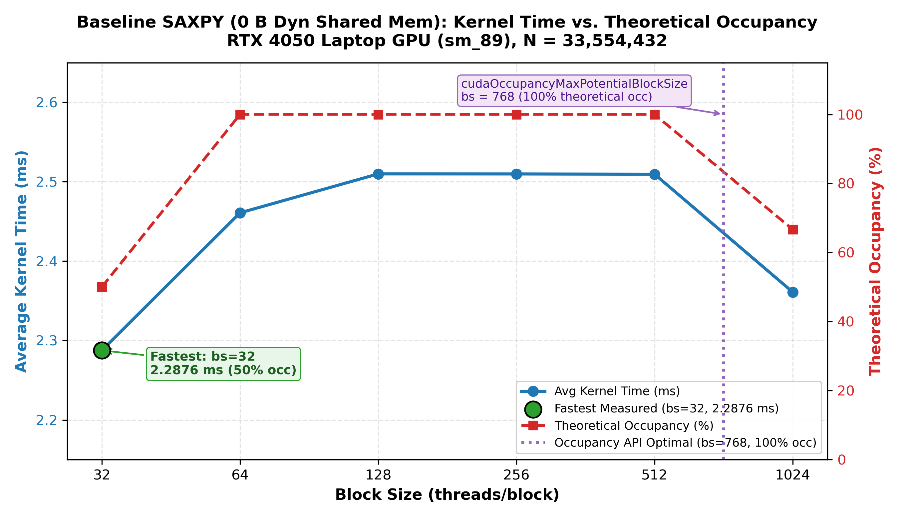
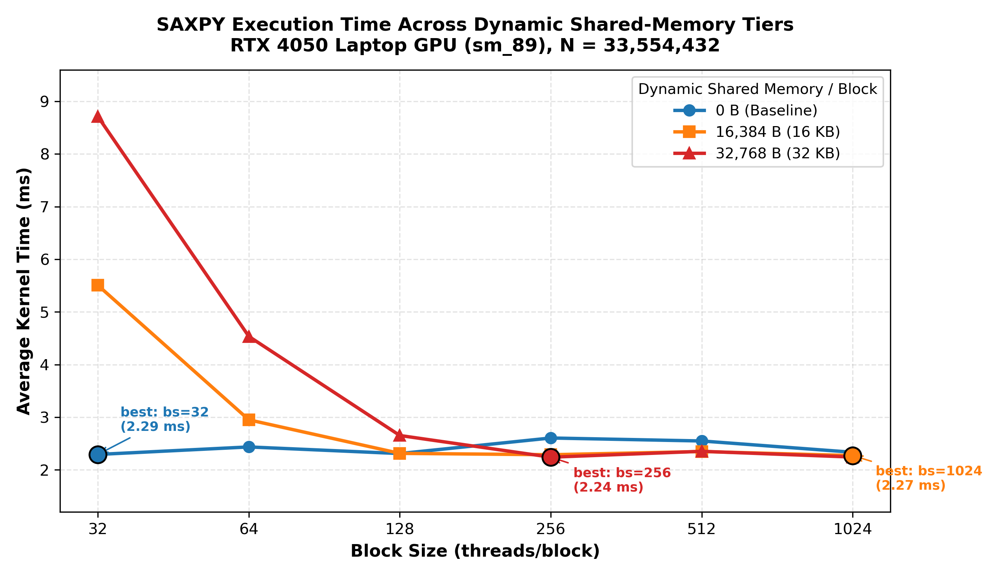
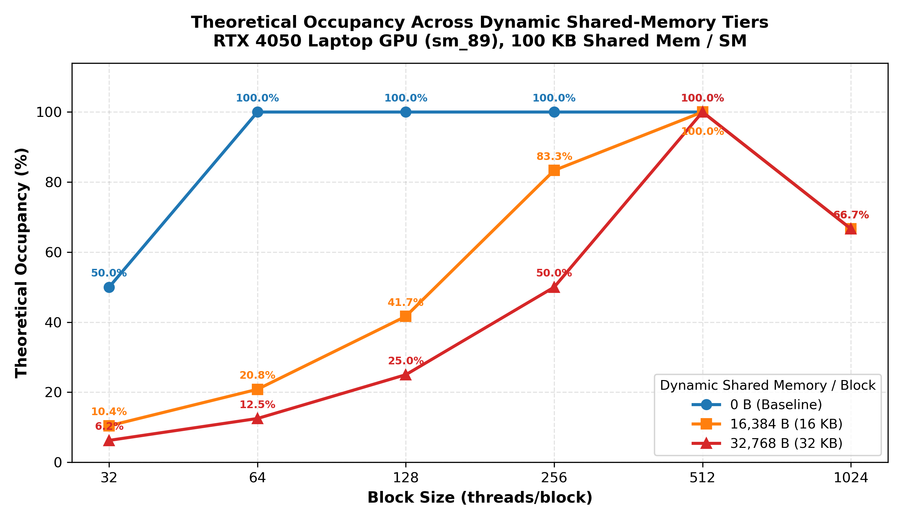
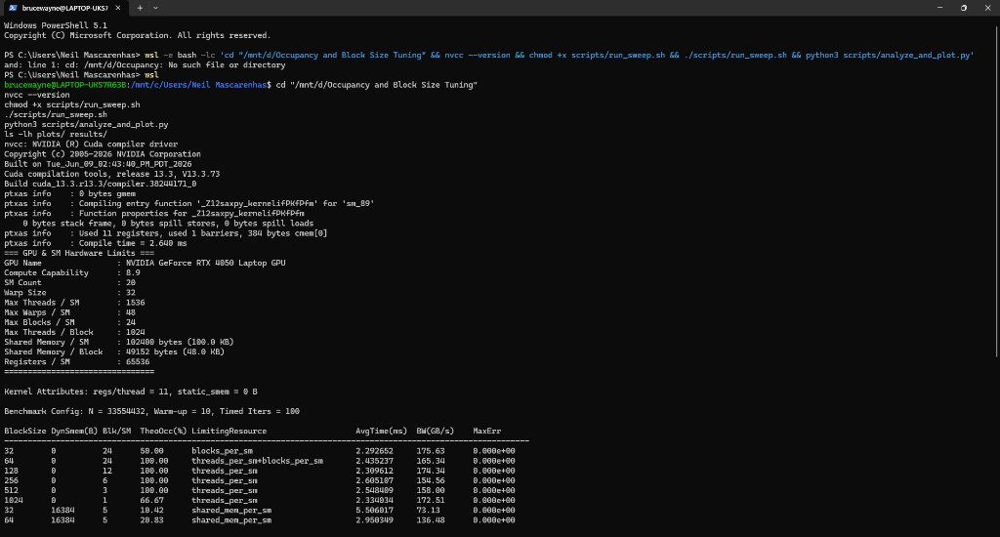
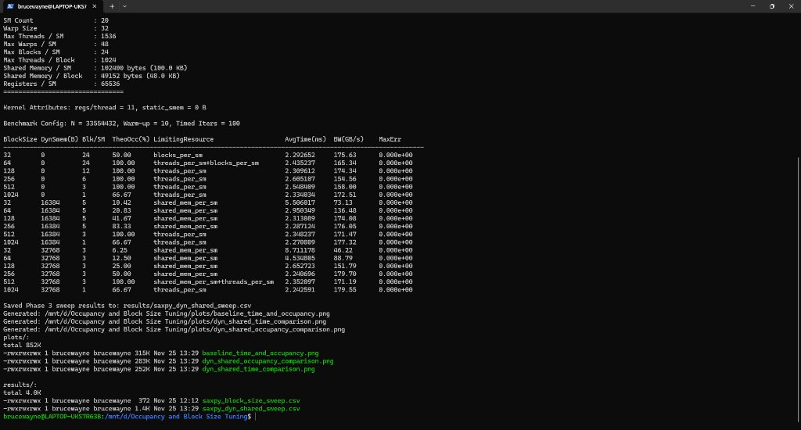

# Theme 5: Occupancy and Block Size Tuning — GPU Kernel Launch Profiler & Benchmarker

## 1. Executive Overview

This project is a **GPU Kernel Occupancy & Launch Configuration Profiler and Benchmarker** built in **CUDA C++** and **Python**. It empirically evaluates how thread block size (`blockDim.x`), compiler-allocated registers per thread, and dynamic shared memory per block (`dyn_shared_bytes`) govern Streaming Multiprocessor (SM) residency, theoretical occupancy, and achieved memory bandwidth on an **NVIDIA GeForce RTX 4050 Laptop GPU (`sm_89`, Ada Lovelace)**.

Using a verified `SAXPY` (`y = a * x + y`) streaming kernel across `N = 33,554,432` single-precision floats (`128 MB` per array, `384 MB` total DRAM traffic per kernel launch), the profiler isolates pure device kernel execution time from host-device transfers and compares NVIDIA's `cudaOccupancyMaxPotentialBlockSize` heuristic against empirical measurements.

**Core Takeaway:**
- **Maximizing theoretical occupancy (100%) does not guarantee the fastest kernel execution.** On `sm_89` with `0 B` dynamic shared memory, `block_size = 32` (`50.00%` theoretical occupancy, `24` active blocks/SM) achieves **`2.287575 ms` (`176.02 GB/s`)**, outperforming all `100.00%` occupancy configurations (`64–512` threads/block at `~2.46–2.51 ms`) as well as `cudaOccupancyMaxPotentialBlockSize`'s recommendation (`block_size = 768`, `100.00%` occupancy).
- **Shared-memory pressure shifts both the hardware bottleneck and the optimal block size.** Adding `16,384 B` (`16 KB`) or `32,768 B` (`32 KB`) of dynamic shared memory per block shifts the limiting resource from `threads_per_sm` / `blocks_per_sm` to `shared_mem_per_sm`, capping active blocks/SM at `5` and `3`. Small blocks (`32`, `64`) suffer severe warp-starvation (`10.42%` and `6.25%` occupancy, slowing to `5.33 ms` and `8.65 ms`), pushing the optimal `shared_mem_per_sm`-limited block size upward: **`32` (`0 B`) → `128` (`16 KB`) → `256` (`32 KB`)**.

---

## 2. Why This Matters (Motivation & Industry Need)

Modern NVIDIA GPUs hide global DRAM access latency (hundreds of clock cycles) by keeping multiple **warps** (groups of 32 threads) resident on each SM and switching between ready warps with zero-cycle overhead. **Occupancy**—the ratio of active warps per SM to the hardware maximum (`48` warps/SM on `sm_89`)—is a primary indicator of latency-hiding capacity, bounded by four per-SM hardware limits:
1. **Max threads / warps per SM** (`1536` threads / `48` warps on `sm_89`)
2. **Max resident blocks per SM** (`24` blocks on `sm_89`)
3. **Register file size per SM** (`65,536` 32-bit registers on `sm_89`)
4. **Shared memory capacity per SM** (`102,400` bytes / `100.0 KB` on `sm_89`)

However, higher occupancy is not free: once enough resident warps exist to saturate the memory controllers and L1/L2 pipelines, pushing to `100%` occupancy increases cache-line contention, DRAM row-buffer conflicts, and warp-scheduler pressure without adding throughput. Conversely, if a kernel's shared memory or register footprint drops occupancy below ~`40%`, SMs run out of eligible warps to mask DRAM latency, causing severe bandwidth collapse.

### Concrete Industry Production Use Case
In **LLM and vision inference engines** (such as **TensorRT-LLM**, **vLLM**, and **PyTorch `torch.compile`**), residual connections (`y = alpha * x + y`), bias additions, and fused elementwise activations (`GeLU`, `SiLU`) are strictly memory-bandwidth-bound streaming kernels with the same arithmetic intensity profile as SAXPY. When a compiler fuses a shared-memory reduction scratchpad or tile-staging buffer into an elementwise epilogue, blindly fixing a small block size (e.g., `64`) or relying solely on `cudaOccupancyMaxPotentialBlockSize` (`768` at `100%` occupancy) can either collapse occupancy under shared-memory limits or leave ~`8–9%` bandwidth on the table at `100%` occupancy. Autotuning `(block_size, dyn_shared_bytes)` around the `~40–50%` occupancy sweet spot (`128–256` threads/block under `16–32 KB` shared memory) directly maximizes achieved memory bandwidth.

---

## 3. System Architecture & How the Project Works

### Repository Layout

```text
.
├── include/
│   ├── cuda_utils.cuh       # CUDA_CHECK macro, SM hardware limit queries, bottleneck classifier
│   └── saxpy_kernel.cuh     # SAXPY kernel with optional dynamic shared memory allocation
├── src/
│   └── saxpy.cu             # CPU reference check, warm-up + cudaEvent_t timing, sweep & CSV export
├── scripts/
│   ├── run_sweep.sh         # Compiles with nvcc -O3 -arch=sm_89 --ptxas-options=-v & runs sweep
│   └── analyze_and_plot.py  # Generates high-resolution PNG charts in plots/ from results/*.csv
├── results/
│   ├── saxpy_block_size_sweep.csv   # Phase 2 baseline block-size sweep (0 B dyn shared mem)
│   └── saxpy_dyn_shared_sweep.csv   # Phase 3 sweep across 0 B, 16384 B, 32768 B dyn shared mem
├── plots/
│   ├── baseline_time_and_occupancy.png
│   ├── dyn_shared_time_comparison.png
│   ├── dyn_shared_occupancy_comparison.png
│   ├── wsl_run_part1.jpg
│   └── wsl_run_part2.jpg
├── docs/
│   └── phase4_analysis.md   # Detailed engineering report & 5-checkpoint deliverable mapping
└── build/                   # Compiled CUDA binaries
```

### End-to-End Execution Pipeline

1. **Hardware & Compiler Introspection**:
   - [`query_device_limits`](file:///d:/Occupancy%20and%20Block%20Size%20Tuning/include/cuda_utils.cuh#L21-L27) reads `cudaDeviceProp` for the **NVIDIA GeForce RTX 4050 Laptop GPU** (`sm_89`): `20` SMs, warp size `32`, `1536` max threads/SM (`48` warps/SM), `24` max blocks/SM, `1024` max threads/block, `102,400` B (`100.0 KB`) shared memory/SM, `49,152` B (`48.0 KB`) shared memory/block, and `65,536` registers/SM.
   - Compiling with `nvcc -O3 -arch=sm_89 --ptxas-options=-v` (CUDA `13.3`, `V13.3.73`) reports kernel resource usage:
     - **Phase 2 baseline kernel (`_Z12saxpy_kernelifPKfPf`)**: `10` registers/thread, `0` barriers, `376` B `cmem[0]`, `0` B static shared memory, `0` B stack/spill.
     - **Phase 3 dynamic-shared kernel (`_Z12saxpy_kernelifPKfPfm`)**: `11` registers/thread, `1` barrier, `384` B `cmem[0]`, `0` B static shared memory, `0` B stack/spill.
2. **Correctness-First Verification**:
   - Before any timing is recorded, `d_y` is reset to `h_y_init`, the kernel executes once, and the output is copied back to host and compared element-by-element against a CPU reference (`a * h_x[i] + h_y_init[i]`). Every configuration must pass `max_err <= 1e-5f` (all runs achieved `0.000e+00`).
3. **Noise-Free CUDA Event Timing**:
   - Each `(block_size, dyn_shared_bytes)` point runs **`10` un-timed warm-up launches** followed by **`100` timed launches** bracketed by `cudaEventRecord(start)` / `cudaEventRecord(stop)` and `cudaEventSynchronize(stop)`—completely excluding host-to-device and device-to-host transfer overhead.
4. **Theoretical Occupancy & Bottleneck Classification**:
   - Queries `cudaOccupancyMaxActiveBlocksPerMultiprocessor` and `cudaOccupancyMaxPotentialBlockSize` via the CUDA Runtime Occupancy API.
   - [`compute_limiting_resource`](file:///d:/Occupancy%20and%20Block%20Size%20Tuning/include/cuda_utils.cuh#L53-L94) evaluates per-SM block bounds from `threads_per_sm`, `blocks_per_sm`, `registers_per_sm`, and `shared_mem_per_sm` to label the active bottleneck.
5. **Dynamic Shared-Memory Stress Testing & Automated Visualization**:
   - [`saxpy_kernel`](file:///d:/Occupancy%20and%20Block%20Size%20Tuning/include/saxpy_kernel.cuh#L5-L21) actively writes and reads `extern __shared__ float s_buf[]` with `__syncthreads()` when `dyn_shared_bytes >= sizeof(float)` so the compiler/runtime cannot optimize away the allocation while preserving exact SAXPY math.
   - Sweeps `dyn_shared_bytes` ∈ `{0, 16384, 32768}` across `block_size` ∈ `{32, 64, 128, 256, 512, 1024}`, exports structured CSVs to `results/`, and generates publication-grade PNG charts via [analyze_and_plot.py](file:///d:/Occupancy%20and%20Block%20Size%20Tuning/scripts/analyze_and_plot.py).

---

## 4. Experimental Results & Comparison Graphs

### 4.1 Phase 2: Baseline Block-Size Sweep (`0 B` Dynamic Shared Memory)

**Config**: `N = 33,554,432` ($2^{25}$ floats), `Warm-up = 10`, `Timed Iters = 100` | Source: [saxpy_block_size_sweep.csv](file:///d:/Occupancy%20and%20Block%20Size%20Tuning/results/saxpy_block_size_sweep.csv)

| Block Size | Grid Size | Active Blocks / SM | Theoretical Occupancy (%) | Avg Time (ms) | Bandwidth (GB/s) | Max Error |
|---:|---:|---:|---:|---:|---:|---:|
| 32 | 1048576 | 24 | 50.00 | 2.287575 | 176.02 | 0.000e+00 |
| 64 | 524288 | 24 | 100.00 | 2.460836 | 163.62 | 0.000e+00 |
| 128 | 262144 | 12 | 100.00 | 2.509845 | 160.43 | 0.000e+00 |
| 256 | 131072 | 6 | 100.00 | 2.509783 | 160.43 | 0.000e+00 |
| 512 | 65536 | 3 | 100.00 | 2.509486 | 160.45 | 0.000e+00 |
| 1024 | 32768 | 1 | 66.67 | 2.360973 | 170.55 | 0.000e+00 |

- **`cudaOccupancyMaxPotentialBlockSize` Prediction**: `block_size = 768` (`min_grid_size = 40`, `2` active blocks/SM, `100.00%` theoretical occupancy).
- **Empirically Fastest Measured**: `block_size = 32` (`2.287575 ms`, `176.02 GB/s`, `24` active blocks/SM, `50.00%` theoretical occupancy).



*Interpretation:* Theoretical occupancy rises from `50.00%` (`bs=32`) to a `100.00%` plateau across `bs=64–512`, then drops to `66.67%` (`bs=1024`). Yet execution time is **lowest** at `bs=32` (`2.2876 ms`) and `bs=1024` (`2.3610 ms`), while the `100%` occupancy plateau runs ~8–9% slower (`~2.46–2.51 ms`).

---

### 4.2 Phase 3: Dynamic Shared-Memory Sweep (`0 B`, `16,384 B`, `32,768 B`)

**Config**: `N = 33,554,432` ($2^{25}$ floats), `Warm-up = 10`, `Timed Iters = 100` | Source: [saxpy_dyn_shared_sweep.csv](file:///d:/Occupancy%20and%20Block%20Size%20Tuning/results/saxpy_dyn_shared_sweep.csv)

| Block Size | Dyn Shared Mem (B) | Active Blocks / SM | Theoretical Occupancy (%) | Limiting Resource | Avg Time (ms) | Bandwidth (GB/s) | Max Error |
|---:|---:|---:|---:|---|---:|---:|---:|
| 32 | 0 | 24 | 50.00 | `blocks_per_sm` | 2.26466 | 177.80 | 0.000e+00 |
| 64 | 0 | 24 | 100.00 | `threads_per_sm+blocks_per_sm` | 2.41976 | 166.40 | 0.000e+00 |
| 128 | 0 | 12 | 100.00 | `threads_per_sm` | 2.33719 | 172.28 | 0.000e+00 |
| 256 | 0 | 6 | 100.00 | `threads_per_sm` | 2.41874 | 166.47 | 0.000e+00 |
| 512 | 0 | 3 | 100.00 | `threads_per_sm` | 2.33080 | 172.75 | 0.000e+00 |
| 1024 | 0 | 1 | 66.67 | `threads_per_sm` | 2.24633 | 179.25 | 0.000e+00 |
| 32 | 16384 | 5 | 10.42 | `shared_mem_per_sm` | 5.32761 | 75.58 | 0.000e+00 |
| 64 | 16384 | 5 | 20.83 | `shared_mem_per_sm` | 2.93968 | 136.97 | 0.000e+00 |
| 128 | 16384 | 5 | 41.67 | `shared_mem_per_sm` | 2.28175 | 176.47 | 0.000e+00 |
| 256 | 16384 | 5 | 83.33 | `shared_mem_per_sm` | 2.29416 | 175.51 | 0.000e+00 |
| 512 | 16384 | 3 | 100.00 | `threads_per_sm` | 2.29985 | 175.08 | 0.000e+00 |
| 1024 | 16384 | 1 | 66.67 | `threads_per_sm` | 2.24397 | 179.44 | 0.000e+00 |
| 32 | 32768 | 3 | 6.25 | `shared_mem_per_sm` | 8.65397 | 46.53 | 0.000e+00 |
| 64 | 32768 | 3 | 12.50 | `shared_mem_per_sm` | 4.53602 | 88.77 | 0.000e+00 |
| 128 | 32768 | 3 | 25.00 | `shared_mem_per_sm` | 2.65348 | 151.75 | 0.000e+00 |
| 256 | 32768 | 3 | 50.00 | `shared_mem_per_sm` | 2.23912 | 179.83 | 0.000e+00 |
| 512 | 32768 | 3 | 100.00 | `shared_mem_per_sm+threads_per_sm` | 2.30224 | 174.90 | 0.000e+00 |
| 1024 | 32768 | 1 | 66.67 | `threads_per_sm` | 2.24369 | 179.46 | 0.000e+00 |





*Interpretation:* Comparing the two charts side-by-side reveals the exact mechanism behind the performance shift:
- **Occupancy Collapse at Small Block Sizes:** At `16,384 B` and `32,768 B`, `shared_mem_per_sm` caps residency at `5` and `3` blocks/SM regardless of block size (`32–256`). At `bs=32`, occupancy collapses from `50.00%` → `10.42%` → `6.25%`, causing kernel time to spike from `2.26 ms` → `5.33 ms` → `8.65 ms`.
- **Upward Shift of the Optimal Block Size:** Increasing `block_size` packs more warps into each shared-memory-limited block, restoring ~`42–50%` occupancy (`20–24` warps/SM) and shifting the fastest `shared_mem_per_sm`-limited configuration from **`bs=32` (`0 B`)** → **`bs=128` (`16,384 B`, `2.28175 ms`, `176.47 GB/s`)** → **`bs=256` (`32,768 B`, `2.23912 ms`, `179.83 GB/s`)** (with `bs=1024` also remaining strong at `~2.24 ms`, `~179 GB/s`).

### 4.3 Obtained WSL2 Terminal Output

Screenshots of the full WSL2 build, sweep, and plotting execution (`./scripts/run_sweep.sh` & `python3 scripts/analyze_and_plot.py`):





---

## 5. Deep Engineering Analysis & Key Findings

1. **Why 50% Occupancy Outperforms 100% Occupancy on Bandwidth-Bound SAXPY (`0 B`):**
   - SAXPY performs 1 FMA per 12 bytes of DRAM traffic (very low arithmetic intensity). On `sm_89`, `20–24` active warps/SM (`41.67–50.00%` occupancy) are already sufficient to saturate the GDDR6 memory controllers.
   - Pushing to `100%` occupancy (`48` warps/SM at `bs=64–512`) increases concurrent L1/L2 cache-line contention and DRAM request-queue pressure without adding memory bandwidth. Meanwhile, `bs=32` runs single-warp blocks with zero intra-block synchronization overhead and fine-grained scheduling across all `20` SMs.
2. **How Shared-Memory Limits Cap Residency and Starve Latency Hiding:**
   - With `102,400 B` shared memory/SM (and hardware allocation granularity/reserved SM overhead), `16,384 B`/block permits at most `5` blocks/SM and `32,768 B`/block permits `3` blocks/SM.
   - Whenever occupancy drops below ~`40%` (`bs=32, 64` at `16 KB`; `bs=32, 64, 128` at `32 KB`), SMs lack enough resident warps to hide global memory latency, reducing achieved bandwidth from `~176–180 GB/s` down to `46.53 GB/s` (a ~3.8x slowdown at `bs=32, 32 KB`).
   - Large blocks (`512`, `1024`) are already `threads_per_sm`-limited (`3` and `1` block/SM), so up to `32 KB` dynamic shared memory leaves their occupancy (`100.00%` and `66.67%`) and runtime (`~2.30–2.33 ms` and `~2.24–2.25 ms`) unchanged.
3. **Recommended Launch Configurations for RTX 4050 Laptop GPU (`sm_89`):**
   - **Zero / Negligible Shared Memory (`0 B`)**: `block_size = 32` (`2.2876 ms`, `176.02 GB/s`, `50.00%` occ) or `block_size = 1024` (`2.2463–2.3610 ms`, `~171–179 GB/s`, `66.67%` occ).
   - **Moderate Shared Memory (`16 KB`/block)**: `block_size = 128` (`2.2818 ms`, `176.47 GB/s`, `41.67%` occ) or `block_size = 1024` (`2.2440 ms`, `179.44 GB/s`, `66.67%` occ).
   - **High Shared Memory (`32 KB`/block)**: `block_size = 256` (`2.2391 ms`, `179.83 GB/s`, `50.00%` occ).
   - **General Rule on `sm_89`**: For memory-bandwidth-bound kernels, target **`40–50%` theoretical occupancy (`20–24` warps/SM)** and scale `block_size` upward (`32 → 128 → 256`) as per-block shared memory increases.

---

## 6. How to Build, Run & Reproduce

Run in **WSL2** from `/mnt/d/Occupancy and Block Size Tuning`:

```bash
# 1. Automated build + sweep (compiles with -O3 -arch=sm_89 --ptxas-options=-v)
bash scripts/run_sweep.sh

# Or compile and run manually:
nvcc -O3 -arch=sm_89 --ptxas-options=-v -Iinclude src/saxpy.cu -o build/saxpy_sweep
./build/saxpy_sweep 33554432 results/saxpy_dyn_shared_sweep.csv

# 2. Generate all high-resolution charts in plots/
python3 scripts/analyze_and_plot.py
```

For the full 5-checkpoint deliverable mapping and raw analysis notes, see [docs/phase4_analysis.md](docs/phase4_analysis.md).
