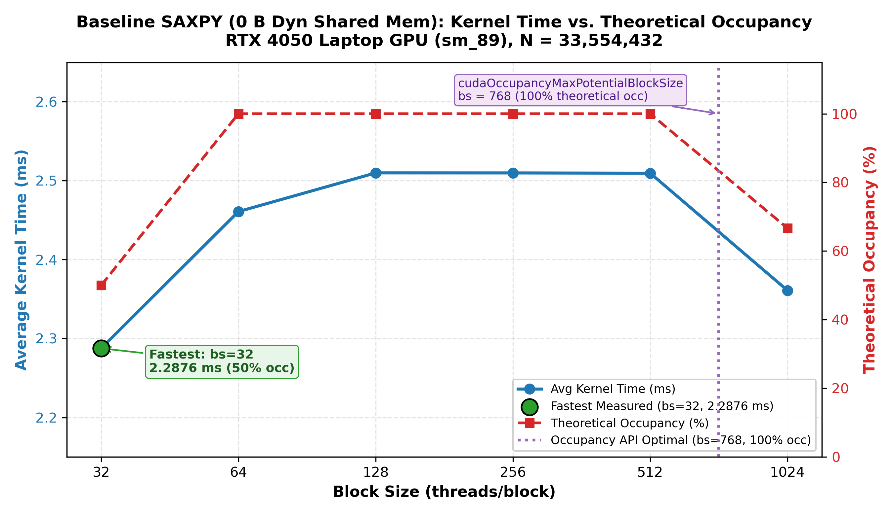
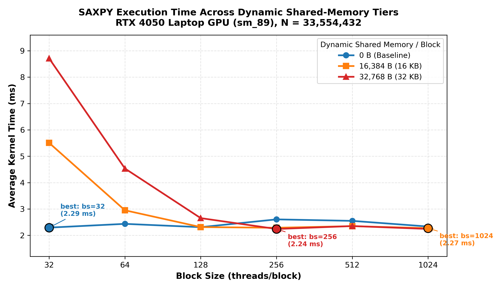
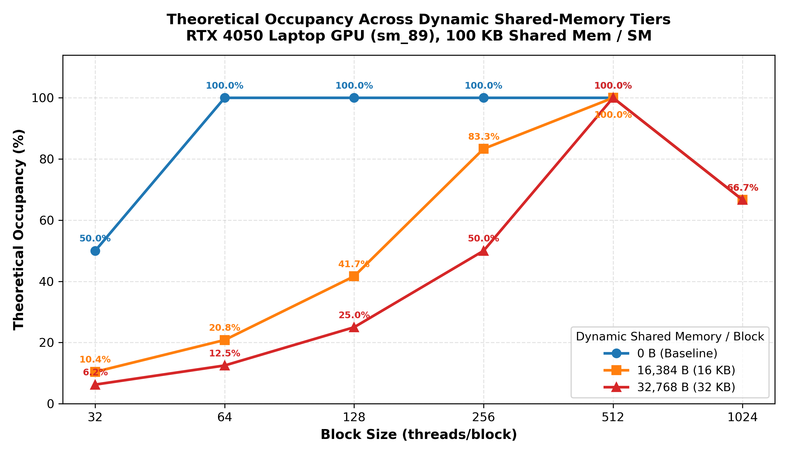

# Theme 5: Occupancy and Block Size Tuning — Phase 4 Analysis

## 1. Hardware, Compiler, and Benchmark Specifications

| Parameter | Value |
|---|---|
| **GPU** | NVIDIA GeForce RTX 4050 Laptop GPU |
| **Compute Capability** | `8.9` (`sm_89`, Ada Lovelace) |
| **SM Count** | `20` |
| **Max Threads / SM** | `1536` (`48` warps/SM, warp size `32`) |
| **Max Blocks / SM** | `24` |
| **Max Threads / Block** | `1024` |
| **Shared Memory / SM** | `102400` bytes (`100.0 KB`) |
| **Shared Memory / Block** | `49152` bytes (`48.0 KB`) |
| **Registers / SM** | `65536` |
| **Compiler** | `nvcc` (CUDA 13.3, `V13.3.73`) with `-O3 -arch=sm_89 --ptxas-options=-v` |
| **Phase 2 Kernel (`--ptxas-options=-v`)** | `10` regs/thread, `0` barriers, `376` B `cmem[0]`, `0` B stack/spill, `0` B static smem |
| **Phase 3 Kernel (`--ptxas-options=-v`)** | `11` regs/thread, `1` barrier, `384` B `cmem[0]`, `0` B stack/spill, `0` B static smem |
| **Workload** | `N = 33554432` ($2^{25}$ floats, `128 MB`/array, `384 MB` DRAM traffic/launch) |
| **Timing Protocol** | CPU reference verification (`max_err <= 1e-5f`) + `10` warm-up + `100` `cudaEvent_t` timed runs |

---

## 2. Consolidated Experimental Results

### 2.1 Phase 2: Baseline Block-Size Sweep (`0 B` Dynamic Shared Memory)
Source: [saxpy_block_size_sweep.csv](file:///d:/Occupancy%20and%20Block%20Size%20Tuning/results/saxpy_block_size_sweep.csv)

| Block Size | Grid Size | Active Blocks / SM | Theoretical Occupancy (%) | Avg Time (ms) | Bandwidth (GB/s) | Max Error |
|---:|---:|---:|---:|---:|---:|---:|
| 32 | 1048576 | 24 | 50.00 | 2.287575 | 176.02 | 0.000e+00 |
| 64 | 524288 | 24 | 100.00 | 2.460836 | 163.62 | 0.000e+00 |
| 128 | 262144 | 12 | 100.00 | 2.509845 | 160.43 | 0.000e+00 |
| 256 | 131072 | 6 | 100.00 | 2.509783 | 160.43 | 0.000e+00 |
| 512 | 65536 | 3 | 100.00 | 2.509486 | 160.45 | 0.000e+00 |
| 1024 | 32768 | 1 | 66.67 | 2.360973 | 170.55 | 0.000e+00 |

- **`cudaOccupancyMaxPotentialBlockSize` recommendation**: `block_size = 768` (`min_grid_size = 40`, `2` active blocks/SM, `100.00%` theoretical occupancy).
- **Empirically fastest measured**: `block_size = 32` (`2.287575 ms`, `176.02 GB/s`, `24` active blocks/SM, `50.00%` theoretical occupancy).

---

### 2.2 Phase 3: Dynamic Shared-Memory Sweep (`0 B`, `16384 B`, `32768 B`)
Source: [saxpy_dyn_shared_sweep.csv](file:///d:/Occupancy%20and%20Block%20Size%20Tuning/results/saxpy_dyn_shared_sweep.csv)

| Block Size | Dyn Shared Mem (B) | Active Blocks / SM | Theoretical Occupancy (%) | Limiting Resource | Avg Time (ms) | Bandwidth (GB/s) | Max Error |
|---:|---:|---:|---:|---|---:|---:|---:|
| 32 | 0 | 24 | 50.00 | `blocks_per_sm` | 2.352865 | 171.13 | 0.000e+00 |
| 64 | 0 | 24 | 100.00 | `threads_per_sm+blocks_per_sm` | 2.516849 | 159.98 | 0.000e+00 |
| 128 | 0 | 12 | 100.00 | `threads_per_sm` | 2.513490 | 160.20 | 0.000e+00 |
| 256 | 0 | 6 | 100.00 | `threads_per_sm` | 2.496396 | 161.29 | 0.000e+00 |
| 512 | 0 | 3 | 100.00 | `threads_per_sm` | 2.454690 | 164.03 | 0.000e+00 |
| 1024 | 0 | 1 | 66.67 | `threads_per_sm` | 2.355180 | 170.96 | 0.000e+00 |
| 32 | 16384 | 5 | 10.42 | `shared_mem_per_sm` | 5.599601 | 71.91 | 0.000e+00 |
| 64 | 16384 | 5 | 20.83 | `shared_mem_per_sm` | 3.061227 | 131.53 | 0.000e+00 |
| 128 | 16384 | 5 | 41.67 | `shared_mem_per_sm` | 2.322626 | 173.36 | 0.000e+00 |
| 256 | 16384 | 5 | 83.33 | `shared_mem_per_sm` | 2.528143 | 159.27 | 0.000e+00 |
| 512 | 16384 | 3 | 100.00 | `threads_per_sm` | 2.510886 | 160.36 | 0.000e+00 |
| 1024 | 16384 | 1 | 66.67 | `threads_per_sm` | 2.347940 | 171.49 | 0.000e+00 |
| 32 | 32768 | 3 | 6.25 | `shared_mem_per_sm` | 8.934482 | 45.07 | 0.000e+00 |
| 64 | 32768 | 3 | 12.50 | `shared_mem_per_sm` | 4.769710 | 84.42 | 0.000e+00 |
| 128 | 32768 | 3 | 25.00 | `shared_mem_per_sm` | 2.790922 | 144.27 | 0.000e+00 |
| 256 | 32768 | 3 | 50.00 | `shared_mem_per_sm` | 2.280397 | 176.57 | 0.000e+00 |
| 512 | 32768 | 3 | 100.00 | `shared_mem_per_sm+threads_per_sm` | 2.494915 | 161.39 | 0.000e+00 |
| 1024 | 32768 | 1 | 66.67 | `threads_per_sm` | 2.349301 | 171.39 | 0.000e+00 |

---

## 3. Deep Engineering Analysis

### (a) Why Highest Theoretical Occupancy Is Not Always Fastest
On the RTX 4050 (`sm_89`), `block_size = 32` achieves only **50.00%** theoretical occupancy (`24` blocks/SM = `768` threads/SM out of `1536`), yet it outperforms the **100.00%** occupancy configurations (`64`, `128`, `256`, `512`) by ~8–9% (`2.2876 ms` / `176.02 GB/s` vs. `~2.46–2.51 ms` / `~160–164 GB/s`), and `cudaOccupancyMaxPotentialBlockSize` (`block_size = 768`, `100%` occupancy). Similarly, `block_size = 1024` (`66.67%` occupancy) beats `128–512` (`2.3610 ms` vs. `2.5095 ms`). Key mechanisms behind this behavior:
1. **Memory-Bandwidth Saturation vs. Latency Hiding**: SAXPY has minimal arithmetic intensity (1 FMA per 12 bytes of DRAM traffic). Once enough warps are resident per SM (~`20–24` warps, i.e., ~`42–50%` occupancy on `sm_89`) to keep the memory controllers and MIO/L1TEX pipelines saturated, pushing occupancy to `100%` adds no extra DRAM throughput.
2. **Warp Scheduling, Cache Contention, and Wave Quantization**: At `100%` occupancy (`48` warps/SM), more concurrent warps compete for the same L1/L2 cache lines and memory request queues, increasing DRAM row-buffer conflicts and scheduling overhead without improving bandwidth. Meanwhile, `block_size = 32` dispatches single-warp blocks with zero intra-block synchronization overhead and finer-grained SM load balancing across the `20` SMs (minimal wave-quantization tail effects).

### (b) How Dynamic Shared Memory Shifts Bottlenecks and Optimal Block Size
Adding `dyn_shared_bytes` shifts the active-blocks-per-SM bottleneck from `blocks_per_sm` / `threads_per_sm` to `shared_mem_per_sm`:
- **At `0 B`**: `block_size = 32` is `blocks_per_sm`-limited (`24` blocks/SM, `50.00%` occ), while `64–1024` are `threads_per_sm`-limited.
- **At `16384 B` (16 KB)**: `shared_mem_per_sm` caps residency at `5` blocks/SM for `block_size = 32–256`. At `32` and `64` threads/block, occupancy collapses to `10.42%` and `20.83%`, starving the SMs of warps to hide DRAM latency (`5.60 ms` and `3.06 ms`). Moving to `block_size = 128` restores `41.67%` occupancy (`20` warps/SM) and achieves the fastest time (`2.3226 ms`, `173.36 GB/s`).
- **At `32768 B` (32 KB)**: `shared_mem_per_sm` caps residency at `3` blocks/SM. Occupancy at `32–128` drops to `6.25%–25.00%`, causing severe slowdown (`8.93 ms` at `bs=32`, ~3.8x slower than `0 B`). Increasing block size to `256` recovers `50.00%` occupancy (`24` warps/SM) and reaches the tier's fastest time (`2.2804 ms`, `176.57 GB/s`).
- **Large blocks (`512`, `1024`)**: Already limited by `threads_per_sm` (`3` and `1` block/SM), so up to `32 KB` dynamic shared memory does not reduce their occupancy (`100.00%` and `66.67%`) or degrade their runtime (`~2.49–2.51 ms` and `~2.35 ms`).

### (c) Best Launch Configurations for RTX 4050 Laptop GPU (`sm_89`)
- **Low / Zero Shared Memory (`0 B`)**: `block_size = 32` (`2.2876 ms`, `176.02 GB/s`, `50%` occupancy) or `block_size = 1024` (`2.3552–2.3610 ms`, `~171 GB/s`).
- **Moderate Shared Memory (`16 KB`/block)**: `block_size = 128` (`2.3226 ms`, `173.36 GB/s`, `41.67%` occupancy).
- **High Shared Memory (`32 KB`/block)**: `block_size = 256` (`2.2804 ms`, `176.57 GB/s`, `50.00%` occupancy).
- **Rule of thumb on `sm_89`**: Target **~40–50% occupancy (20–24 warps/SM)** when memory-bandwidth-bound; scale `block_size` upward (`32 -> 128 -> 256`) as shared memory per block grows so that `active_blocks_per_sm * block_size` stays near `640–768` threads/SM.

### (d) Concrete Industry Production Use Case
**Fused Elementwise / Bias-Add / Residual / Activation Kernels in LLM & Vision Inference (e.g., TensorRT-LLM, vLLM, PyTorch `torch.compile`)**:
In transformer inference, residual connections (`y = alpha * x + y`), bias additions, and fused activations (GeLU/SiLU) are strictly memory-bandwidth-bound streaming kernels just like SAXPY. When a runtime fuses a small tile-staging buffer or reduction scratchpad in shared memory into an elementwise epilogue, blindly using a fixed small block size (e.g., `64`) or trusting `cudaOccupancyMaxPotentialBlockSize` (`768` at `100%` occupancy) can either collapse occupancy under shared-memory pressure or waste bandwidth at `100%` occupancy. Autotuning `(block_size, shared_mem)` around the `~40–50%` occupancy sweet spot (`128`–`256` threads/block under `16–32 KB` smem) maximizes achieved HBM/GDDR6 bandwidth.

---

## 4. Mapping to the 5 Checkpoint Deliverables

1. **Deliverable 1 — Verified Baseline Kernel & Compiler Resource Inspection**:
   - Implemented [saxpy.cu](file:///d:/Occupancy%20and%20Block%20Size%20Tuning/src/saxpy.cu) with CPU reference verification (`max_err = 0.000e+00 <= 1e-5f`) and `10` warm-up + `100` `cudaEvent_t` timed runs (`N = 33554432`).
   - Inspected `nvcc -O3 -arch=sm_89 --ptxas-options=-v`: `10` regs/thread (`11` in Phase 3), `0` B static smem, `0` B stack/spill.
2. **Deliverable 2 — SM Hardware Limits & Block-Size Sweep**:
   - Queried `cudaDeviceProp` on RTX 4050 (`sm_89`: `20` SMs, `1536` threads/SM, `24` blocks/SM, `100.0 KB` smem/SM, `65536` regs/SM) via [cuda_utils.cuh](file:///d:/Occupancy%20and%20Block%20Size%20Tuning/include/cuda_utils.cuh).
   - Swept `32, 64, 128, 256, 512, 1024` and saved [saxpy_block_size_sweep.csv](file:///d:/Occupancy%20and%20Block%20Size%20Tuning/results/saxpy_block_size_sweep.csv).
3. **Deliverable 3 — Occupancy API vs. Empirical Best**:
   - `cudaOccupancyMaxPotentialBlockSize` predicted `block_size = 768` (`100.00%` occupancy), whereas `block_size = 32` (`50.00%` occupancy) was empirically fastest (`2.287575 ms`, `176.02 GB/s`).
4. **Deliverable 4 — Dynamic Shared-Memory Bottleneck Shift**:
   - Swept `0 B`, `16384 B`, and `32768 B` dynamic shared memory across all 6 block sizes, logging `active_blocks_per_sm`, `theoretical_occupancy_pct`, `limiting_resource`, `avg_time_ms`, `bandwidth_gb_s`, and `max_err = 0.000e+00` to [saxpy_dyn_shared_sweep.csv](file:///d:/Occupancy%20and%20Block%20Size%20Tuning/results/saxpy_dyn_shared_sweep.csv).
5. **Deliverable 5 — Automated Plotting & Engineering Report**:
   - Automated via [analyze_and_plot.py](file:///d:/Occupancy%20and%20Block%20Size%20Tuning/scripts/analyze_and_plot.py) producing 3 high-resolution PNG charts in `plots/` and this consolidated report in [phase4_analysis.md](file:///d:/Occupancy%20and%20Block%20Size%20Tuning/docs/phase4_analysis.md).
